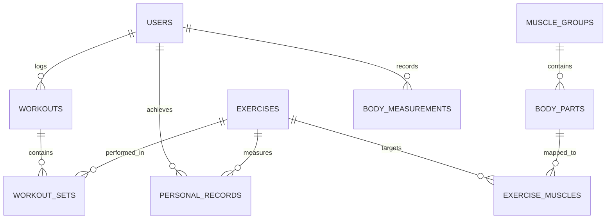

# Workout Tracker Database

A MySQL database for logging gym sessions, mapping exercises to muscles, and tracking strength progress.

**Author:** Jacob Butler  
**Course:** CGS2545C · Spring 2026  
**Project type:** Academic database project, prepared for a public portfolio

## Why I built it

Workout logs can record what happened without making progress easy to examine. This project organizes sessions, individual sets, muscle targets, personal records, and body measurements so SQL queries can answer questions such as “How has my bench press changed?” and “How much training volume did each muscle group receive?”

## What it demonstrates

- Nine related tables with primary keys, foreign keys, uniqueness rules, and validation constraints.
- A many-to-many exercise/body-part relationship with primary and secondary activation labels.
- INNER JOINs, LEFT JOINs, subqueries, grouping, and date-based reports.
- Two reporting views and an insert trigger that maintains single-repetition personal records.
- Fictional sample data: 5 users, 18 exercises, 10 sessions, and 39 logged sets.

## Database relationships



[Full diagram with attributes](docs/erd.md) · [Design notes](docs/design-notes.md)

## Run the project

Use MySQL 8.0.16 or later with an account allowed to create a database, tables, views, and triggers. This package has not yet been executed on a MySQL server; see the validation notes below.

From the project folder, connect using your own MySQL account:

```sh
mysql -u YOUR_MYSQL_USER -p
```

Then run the files in this order inside the MySQL client:

```sql
SOURCE sql/00_create_database.sql;
SOURCE sql/01_schema.sql;
SOURCE sql/02_sample_data.sql;
SOURCE sql/03_views.sql;
SOURCE sql/04_trigger.sql;
SOURCE sql/06_verify.sql;
SOURCE sql/05_queries.sql;
```

The first file creates `workout_tracker_portfolio`. If that name already exists, stop and choose a new name consistently in the SQL files. Run subsequent files only after each previous file succeeds. The scripts do not delete an existing database and contain no credentials. In MySQL Workbench, open and execute the same files in order; execute trigger creation as the full script so its delimiter is handled.

## Example: bench press progress

```sql
SELECT WorkoutDate, MaxWeightLifted, TotalReps
FROM vw_bench_progression
WHERE Username = 'athlete_a'
ORDER BY WorkoutDate;
```

Expected results from the included sample data:

| Workout date | Heaviest set (kg) | Total reps |
| --- | ---: | ---: |
| 2026-03-01 | 100.00 | 21 |
| 2026-03-08 | 102.50 | 21 |

## Example: training volume

```sql
SELECT YearWeek, MuscleGroup, TotalSets, TotalVolume_kg
FROM vw_weekly_volume
WHERE Username = 'athlete_a'
ORDER BY YearWeek, MuscleGroup;
```

Volume is the sum of weight × repetitions for each logged set. A set counts once per primary muscle group, even if multiple targeted body parts belong to that group. A compound lift may count toward more than one group, so do not add muscle-group totals to estimate overall session volume. Bodyweight sets with a recorded load of zero contribute zero to this external-load measure.

## Trigger demonstration

Run `sql/07_trigger_demo.sql` after setup. It temporarily inserts a heavier single-repetition bench set, shows the personal record changing from 120 kg to 130 kg, and rolls the transaction back. The trigger uses the workout date and retains the previous date when a new set does not beat the record.

## Scope and validation

This repository contains the SQL database and documentation. An app interface, automatic training recommendations, and charts are future extensions. Muscle labels and volume reports illustrate database relationships; they do not diagnose overtraining.

Sample relationships, row counts, and reporting calculations are checked independently during packaging. MySQL execution remains to be verified: the available local server crashed during initialization. `sql/06_verify.sql` supplies checks to run on a working MySQL installation. [Validation details](docs/validation.md)

## Portfolio preparation

This version follows the nine-table schema and sample data used in my final course presentation. It replaces sample usernames and email addresses, separates setup from queries, fixes the weekly-volume view, and corrects personal-record date handling. [Preparation notes](docs/design-notes.md#portfolio-preparation)
